Всем кискам "Пис!" - я из НИТУ МИСИС

<p align="center">

</p>

# PiezoOrchestra

<p align="center">
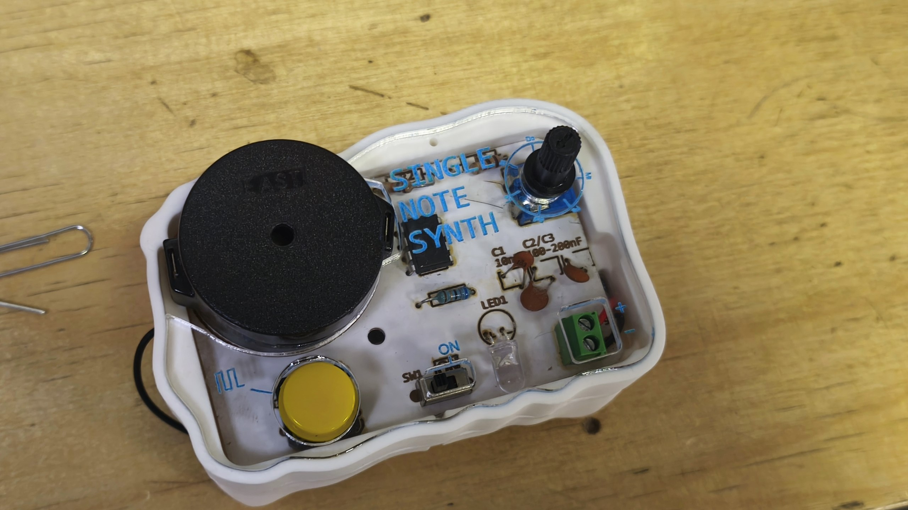
</p>

## Содержание

<p align="center">
   
* [PiezoOrchestra](#piezoorchestra)
    * [1. Электроника и расчеты](#1-электроника-и-расчеты)
    * [2. Веб-инструменты и визуализация ШИМ](#2-веб-инструменты-и-визуализация-шим)
    * [3. Изготовление печатной платы](#3-изготовление-печатной-платы)
    * [4. Корпус и сборка](#4-корпус-и-сборка)
    * [5. Подбор мелодии и тестирование](#5-подбор-мелодии-и-тестирование)
    * [6. Итог](#6-итог)

</p>


# PiezoOrchestra

## `1. Электроника и расчеты`

<details>
  <summary><b>Нажмите, чтобы развернуть текст</b></summary><br>

**Необходимые электронные компоненты (на один модуль):**
- [ ] Таймер NE555 (генератор импульсов);
- [ ] Пьезоэлектрический излучатель (пассивный пьезо-баззер);
- [ ] Постоянные резисторы ($R_a$, $R_b$) и конденсаторы ($C$) для задания базовой частоты: $R_1 = 1$ kOhm, $R_2 = 10$ kOhm, $R_3 = 50$ Ohm, $C_1 = 10$ nF, 2 x $C_2 = 100$ nF;
- [ ] Потенциометр для точной подстройки (калибровки) тона и диапазона частот на 10 kOhm;
- [ ] Slide Switch;
- [ ] Push Button;
- [ ] LED;
- [ ] Литий-ионный аккумулятор 18650 (3.7 - 4.2 V) и батарейный отсек;
- [ ] Соединительные провода.

Электрическая схема от [m112521](https://github.com/m112521):

[](https://github.com/m112521/555-synth)

[](https://github.com/m112521/555-synth)


https://github.com/user-attachments/assets/e7753eda-e220-4741-98c7-0249963bd43f

<p align="center">
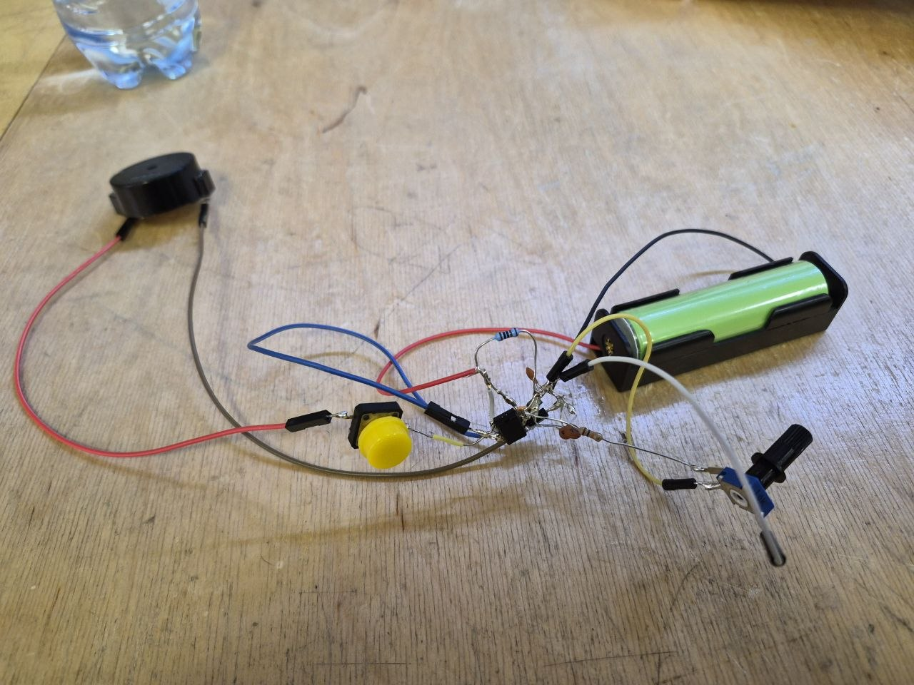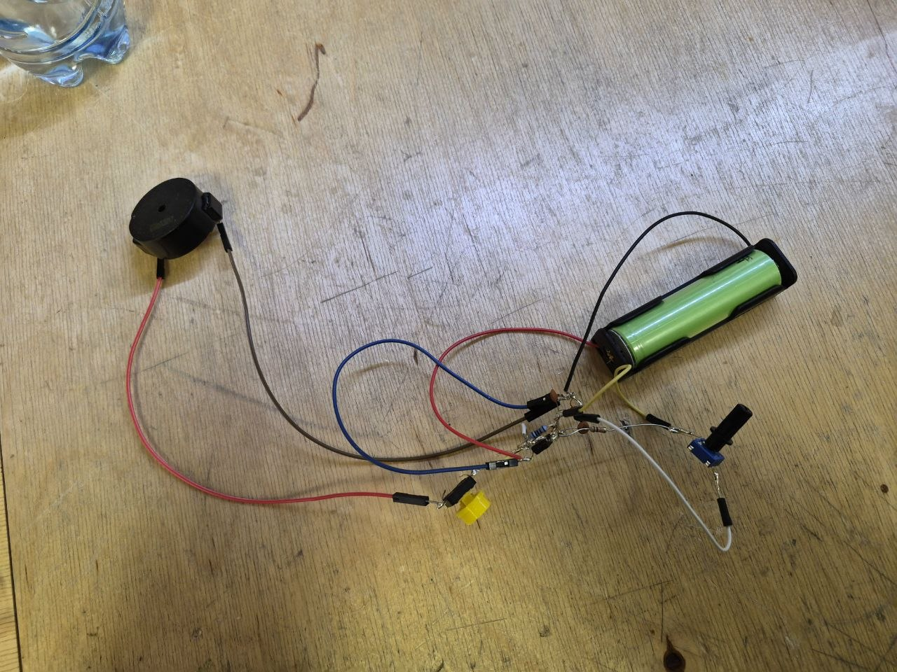
</p>

**Принцип работы и настройка:**
Схема построена на базе генератора прямоугольных импульсов (ШИМ). Частота звука зависит от номиналов резисторов и емкости конденсатора в RC-цепи. 

Чтобы каждый модуль звучал чисто и попадал в свою ноту, мы заранее рассчитали необходимые номиналы компонентов под целевой диапазон частот (от 500 до 700 Гц). После расчетов схема была собрана навесным монтажом и проверена на осциллографе для подтверждения точности выходной частоты и скважности сигнала.

</details>

## `2. Веб-инструменты и визуализация ШИМ`

<details>
  <summary><b>Нажмите, чтобы развернуть текст</b></summary><br>
   
Чтобы автоматизировать подбор резисторов и конденсаторов, был разработан веб-калькулятор и развернут на **GitHub Pages**.

**Функционал калькулятора:**
1. Расчет выходной частоты ($f$) по заданным номиналам $R_a$, $R_b$ и $C$.
2. Обратный расчет номиналов резисторов под нужную частоту ноты и коэффициент заполнения ($D$).
3. Расчет коэффициента заполнения импульсов.

[**Калькулятор**](https://meyriska.github.io/PiezoOrchestra/ "Тык")


Дополнительно на библиотеке `p5.js` была написана интерактивная визуализация широтно-импульсной модуляции (ШИМ). С помощью ползунка можно менять коэффициент заполнения (Duty Cycle) и в реальном времени наблюдать, как меняется форма прямоугольного сигнала и яркость виртуального светодиода.

<details>
<summary>Посмотреть исходный код анимации ШИМ (p5.js)</summary>

```javascript
let n = 10;
let amp = 50;
let dutyCycle = 0.5;
let dutyPercent = dutyCycle * 100;
let step = 0.005;

function setup() {
  createCanvas(windowWidth, windowHeight);
  strokeWeight(2);
  slider = createSlider();
}

function draw() {
  background(27, 27, 27); 

  push();
  dutyCycle = slider.value() / 100;
  pop();
  
  push(); 
  let offset = 0;
  let originX = offset;
  let originY = height / 2 + amp;

  stroke(255, 255, 255, 30);
  strokeWeight(1);
  for (let x = originX; x < width; x += width / n) {
    line(x, 0, x, height);
  }
  
  stroke(0, 150, 255);
  strokeWeight(4);
  line(originX, originY, width - 20, originY);
  triangle(width - 20, originY - 5, width - 20, originY + 5, width - 10, originY);
  line(originX, originY, originX, 20);
  triangle(originX - 5, 20, originX + 5, 20, originX, 10);
  pop();

  let period = width / n;
  let pulseWidth = period * dutyCycle;

  dutyCycle += step;
  if (dutyCycle > 1 || dutyCycle < 0) {
    step = -step; 
  }
  
  push();
  translate(0, height / 2);
  stroke(0, 255, 200);
  beginShape();
  let x = 0;
  for (let i = 0; i < n; i++) {
    vertex(x, -50);
    x += pulseWidth;
    vertex(x, -50);
    vertex(x, 50);
    x += (period - pulseWidth);
    vertex(x, 50);
    if (i < n - 1) {
      vertex(x, -50);
    }
  }
  endShape();
  pop();
  
  noStroke();
  fill(255);
  textSize(24);
  textAlign(CENTER);
  text("Duty Cycle: " + nf(dutyCycle * 100, 0, 1) + "%", width / 2, height * 0.7);

  fill(255, 0, 255, dutyCycle * 255);
  stroke(138, 43, 226);
  strokeWeight(2);
  ellipse(width / 2, height * 0.85, 80);
}
```
</details>

<mark>ССЫЛКА НА ОБЛАЧНОЙ СРЕДЕ РЕДАКТИРОВАНИЯ И ЗАПУСКА p5.js ИЛИ АНИМАЦИЯ СЮДА.</mark>

</details>

## `3. Изготовление печатной платы`

<details>
  <summary><b>Нажмите, чтобы развернуть текст</b></summary><br>

После успешной проверки прототипа мы перенесли схему на текстолит методом химического травления.

**Состав травильного раствора (на 5000 мм² меди):**
* Перекись водорода — 50 мл;
* Лимонная кислота — 15 г;
* Поваренная соль — 2.5 г.

После травления и сверления отверстий плата была покрыта защитным слоем краски, а все радиодетали аккуратно перенесены и запаяны на свои места.

<p align="center">
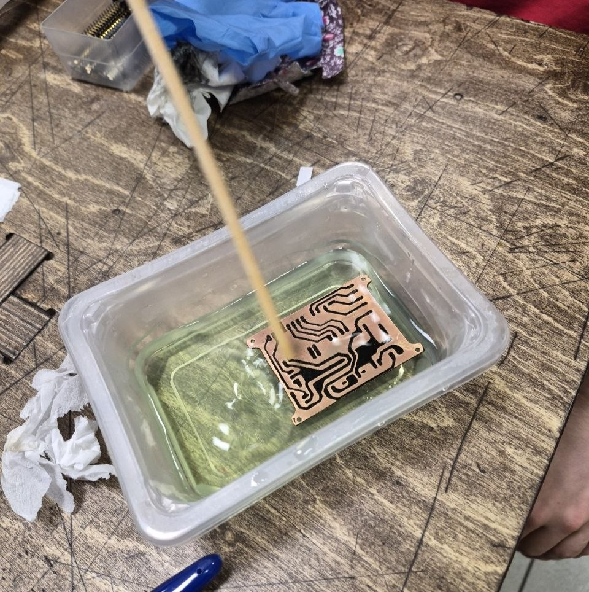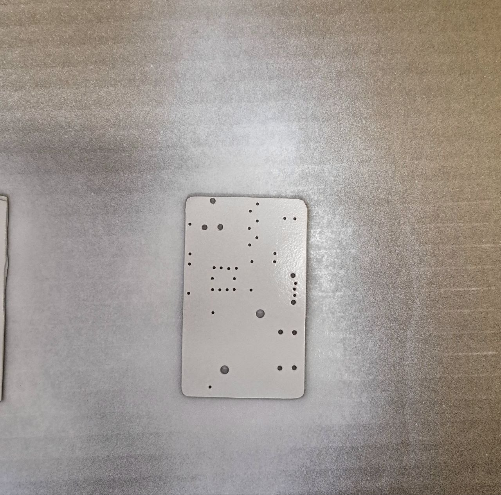
</p>

</details>

## `4. Корпус и сборка`

<details>
  <summary><b>Нажмите, чтобы развернуть текст</b></summary><br>
   
Для защиты электроники и удобства использования во время игры на 3D-принтере были напечатаны корпуса. Внутри разместились плата с генератором и аккумуляторный отсек, а на верхнюю панель были выведены кнопка без фиксации для активации звука и ручка потенциометра для подстройки тона.

<p align="center">
<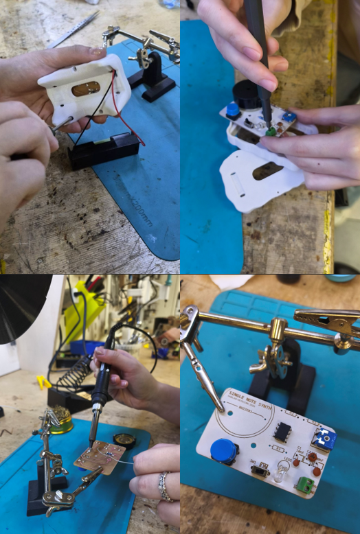
</p>

</details>

## `5. Подбор мелодии и тестирование`

<details>
  <summary><b>Нажмите, чтобы развернуть текст</b></summary><br>
   
На финальном этапе мы провели музыкальную калибровку:
1. Выбрали музыкальное произведение и разобрали его партитуру на отдельные ноты.
2. Распределили ноты между участниками команды.
3. С помощью потенциометров точно подстроили частоту каждого модуля под выбранную ноту.

<p align="center">
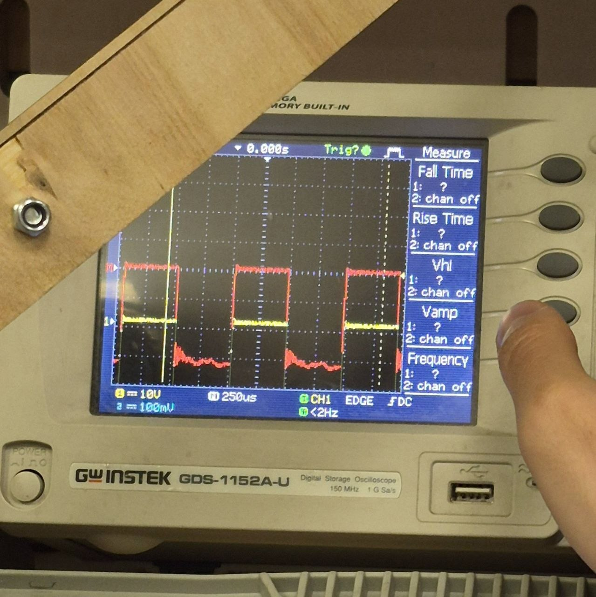
</p>

```text
До# 524
Ре 587
Ми 660
Фа 698
Соль 784

Ре фа ми ре до# ре ми ре ми ре ми фа фа фа
Ми ре до# си(бекар) до ре ре фа ми ре
До# ре ми ре соль фа ми ре
```

<p align="center">
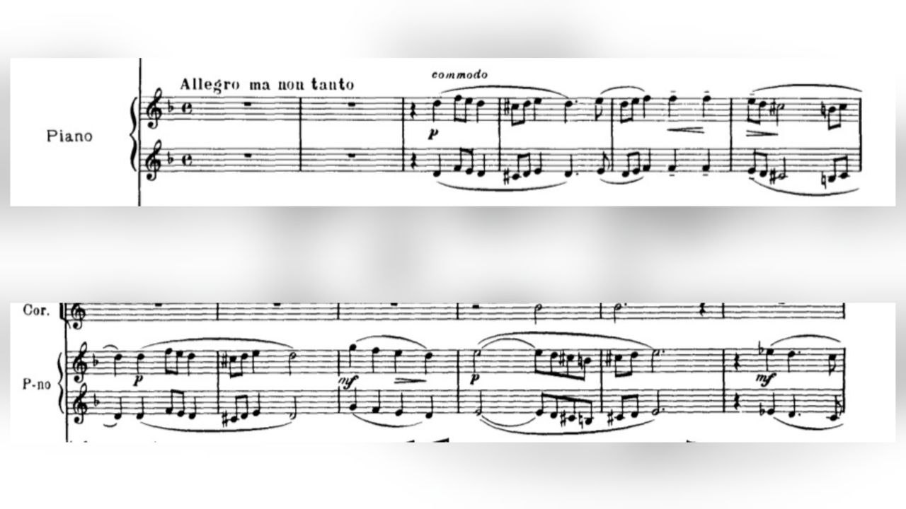
</p>

</details>

## `6. Итог`

Мы создали автономный модульный синтезатор и провели совместное выступление, исполнив мелодию в формате живого электронного ансамбля. Каждый участник отвечал за свою ноту и вовремя активировал свой модуль, превратив группу людей в единый музыкальный инструмент.

Наша команда отвечала за ноту Соль второй октавы (G5) - 784 Гц.

<p align="center">
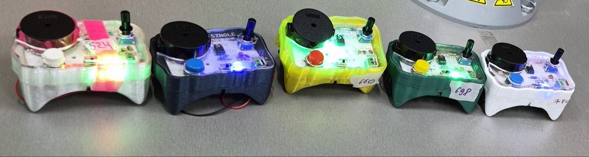
</p>

https://github.com/user-attachments/assets/f43c3c23-33ad-455c-b821-dd59fee725a9

[]


<p align="center">

</p>


<p align="center">
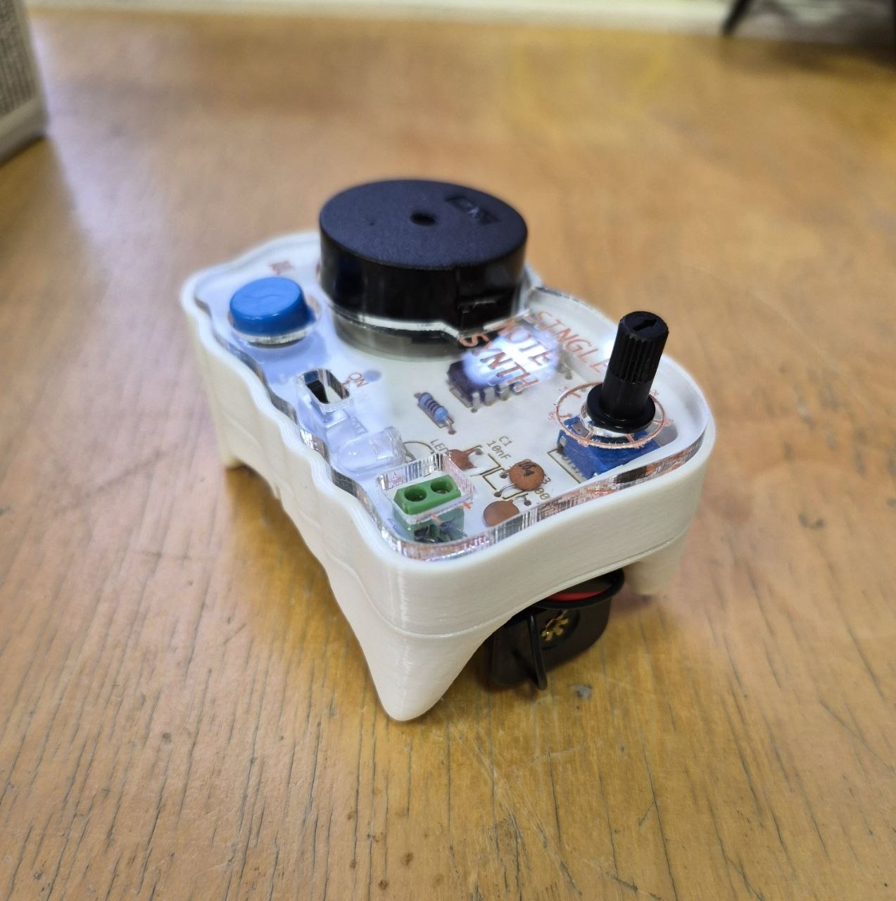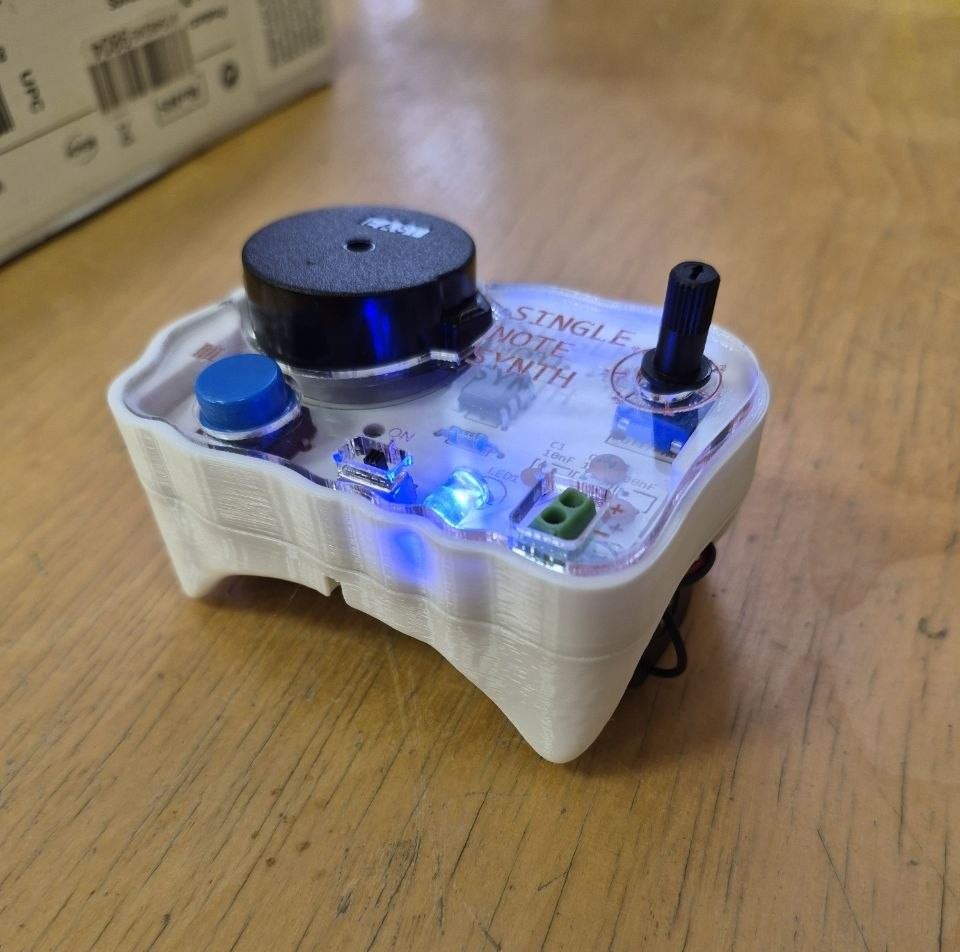
</p>


-------------
